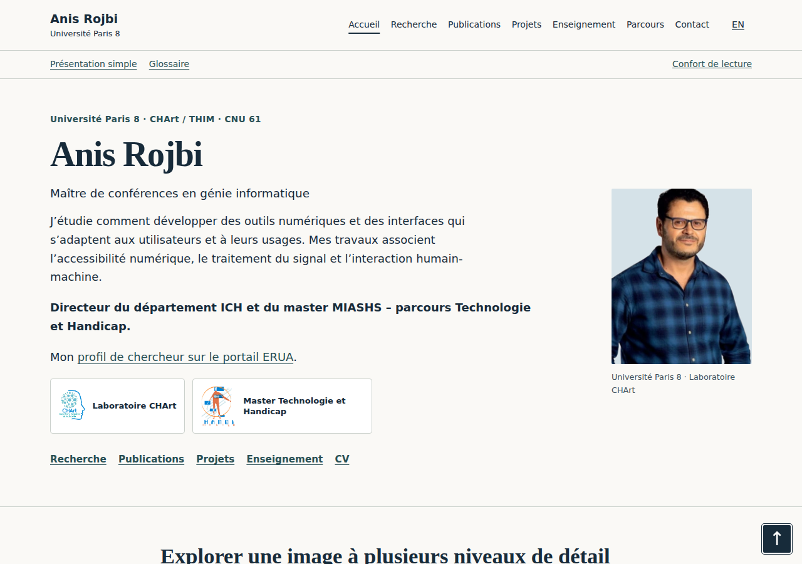
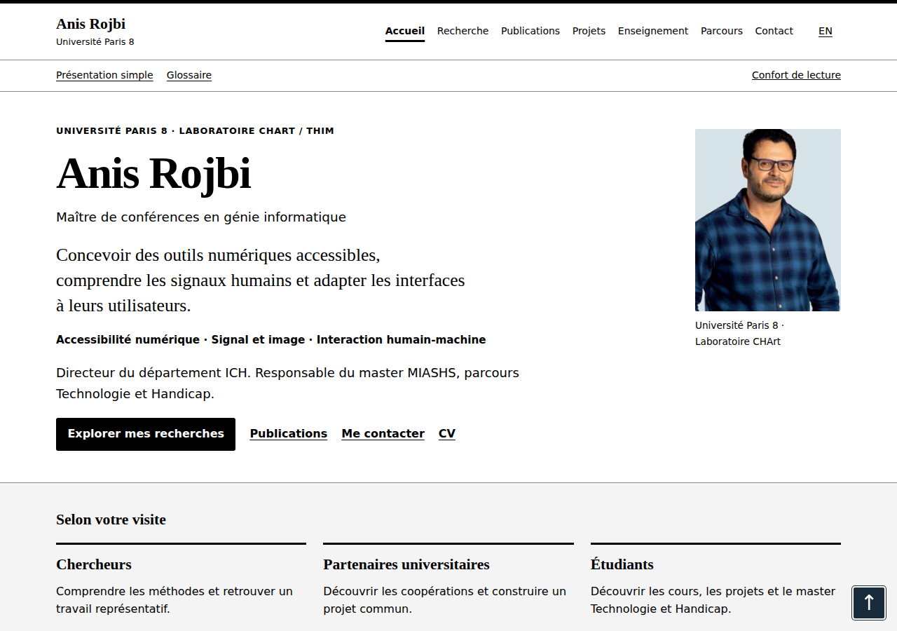
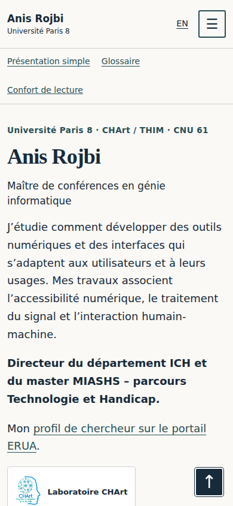
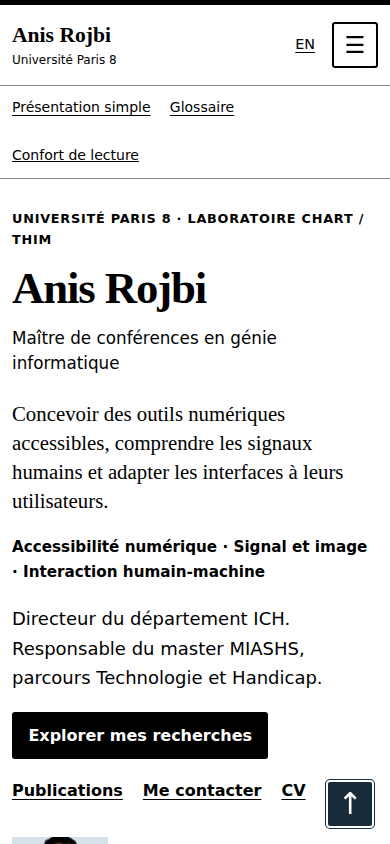
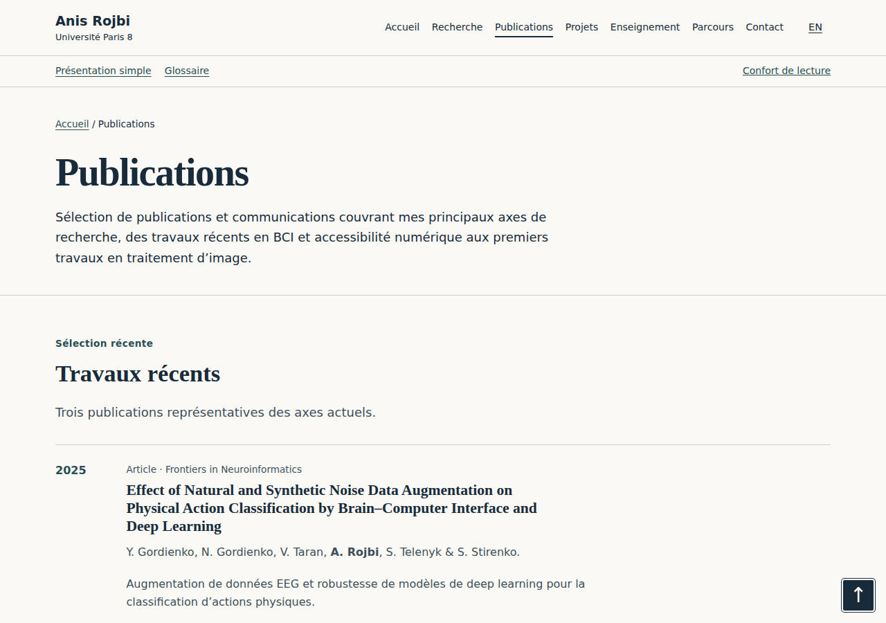
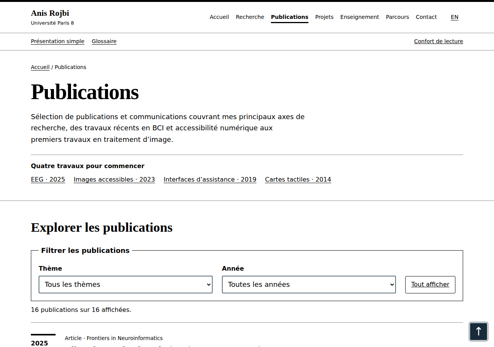
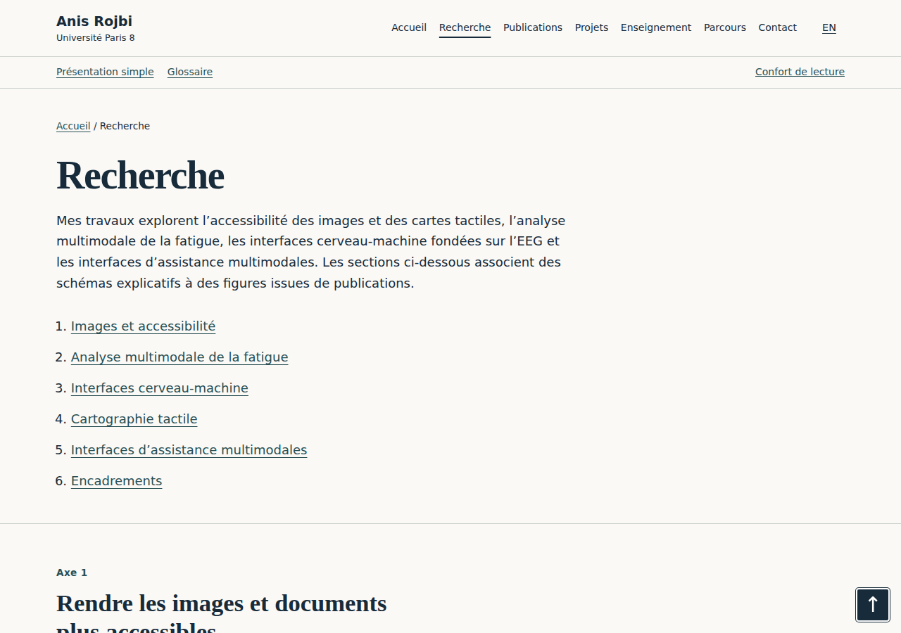
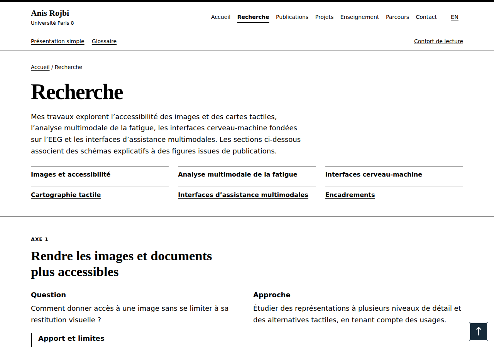

# Ergonomie et valorisation scientifique — 15 novembre 2026

Site : https://anisrojbi.fr/ · Dépôt : https://github.com/anisrbp8/anisrbp8.github.io

La version de départ a été lue dans le dépôt et sur le site public. Les changements antérieurs (SEO, contraste, schémas et versions anglaises) sont conservés. Le commit de référence `deb373d90fdebeea70b602d991c7c19c39dd2aab` ajoute uniquement les outils de capture ; son rendu est celui de `64f60e09b5e6d2f19c8a940bb73c6f2b40f0928a`.

## Constats et décisions

| Observation directe avant modification | Changement réalisé | Ce qui reste une hypothèse à tester |
|---|---|---|
| Accueil long, avec des accès et présentations thématiques répétés ; l'article EEG n'apparaissait qu'après plusieurs sections. | Présentation courte de l'identité, accès Recherche/Publications/Contact/CV, trois entrées selon le visiteur, une mise en avant scientifique. | Une entrée par public devrait accélérer l'orientation ; aucun temps de tâche utilisateur n'a été mesuré. |
| Les cinq axes possédaient déjà des figures, mais leurs contributions, limites et liens bibliographiques étaient inégalement explicites. | Chaque axe distingue question, approche et contribution/limites ; sommaire et liens croisés. Les explications secondaires sont dépliables. | La compréhension des textes par des étudiants doit être testée avec eux. |
| Publications essentiellement consultées dans une longue liste ; peu de repères pour choisir un premier article. | Quatre travaux pour commencer, liste chronologique unique, filtres thème/année et référence copiable. | L'utilité relative du filtre année et du filtre thème reste à observer. |
| Légende de la figure 8 décrivant des courbes en fonction de N, alors que l'image montre des barres par action. | Légendes et descriptions FR/EN corrigées d'après le graphique, sans estimation de valeurs à partir de l'image. | Aucune nouvelle conclusion scientifique n'est déduite de l'illustration. |
| Le redimensionnement d'un menu mobile ouvert vers le bureau pouvait perdre le focus visible. | Le focus est replacé sur une destination visible ; menu et agrandisseur vérifiés au clavier. | Les usages tactiles et lecteurs d'écran sur appareils physiques restent à tester. |

## Modifications publiées

- Accueil FR/EN : identité et domaines lisibles dès le haut de page, chemins chercheurs/partenaires/étudiants, aperçu EEG authentique, logos CHArt et master conservés et optimisés.
- Recherche FR/EN : cinq axes, contributions et limites, repères de navigation, publications et coopérations associées. Figures authentiques 2 et 8 de Frontiers ; schémas du séminaire conservés. Les schémas tactile et assistance sont explicitement des synthèses explicatives, pas des résultats expérimentaux.
- Publications FR/EN : 16 références, quatre entrées représentatives, résumés d'apport, filtres combinables, état « aucun résultat », ancrages stables et copie d'une référence textuelle.
- Projets, enseignement et contact FR/EN : sommaires ou accès directs utiles, liens recherche/projets/contact, informations officielles du master et CV.
- Style partagé : texte principal noir sur blanc (21:1), hiérarchie éditoriale, largeur de lecture limitée, espacements et focus visibles. Les figures scientifiques gardent leurs couleurs d'origine et disposent d'explications textuelles.
- Interactivité progressive : le JavaScript enrichit des contenus HTML déjà accessibles. Sans JavaScript, les 16 publications, les références et les liens vers les images originales restent consultables. Aucun nouveau service ni abonnement ajouté.

## Fidélité scientifique et crédits

1. **EEG / neuroinformatique.** Gordienko Y., Gordienko N., Taran V., Rojbi A., Telenyk S., Stirenko S. (2025), *Effect of Natural and Synthetic Noise Data Augmentation on Physical Action Classification by Brain–Computer Interface and Deep Learning*, Frontiers in Neuroinformatics 19:1521805. [Article intégral](https://www.frontiersin.org/journals/neuroinformatics/articles/10.3389/fninf.2025.1521805/full), [DOI](https://doi.org/10.3389/fninf.2025.1521805), [CC BY 4.0](https://creativecommons.org/licenses/by/4.0/). Figures 2 et 8 redimensionnées et recompressées sans recadrage ni changement des annotations. L'agrandissement charge le fichier original de l'éditeur. Figure 2 : échelle propre à chaque ligne, temps en ms, potentiel en µV. Figure 8 : AUC moyenne pour six actions, offsets 0 / 0,5 / 1, sans bruit puis bruit d'écart-type 0,2 ; barres d'erreur décrites sans extrapolation. Les limites du protocole et l'absence de généralisation universelle sont indiquées.
2. **Images accessibles.** Rojbi S., Rojbi A., Gouider M. S. (2023), *Enhancing the Accessibility of Images on the Web: A Holistic View and New Perspectives*. [PDF de l'éditeur](https://eirai.org/images/proceedings_pdf/DiR0523101.pdf), DOI 10.17758/EIRAI18.DiR0523101. Présentation comme synthèse de stratégies et perspectives ; aucune validation d'une solution universelle n'est attribuée au texte.
3. **Cartes tactiles.** Bouhlel N., Rojbi A. (2014), *New Tools for Automating Tactile Geographic Map Translation*, ACM ASSETS, pp. 313–314. [DOI](https://doi.org/10.1145/2661334.2661335). Résumé et programme officiel consultés. Schéma original de synthèse, clairement identifié. Le titre accessible du lien DOI a été corrigé.
4. **Interfaces d'assistance.** *User-Driven Intelligent Interface on the Basis of Multimodal Augmented Reality and Brain-Computer Interaction for People with Functional Disabilities* : [DOI](https://doi.org/10.1007/978-3-030-03402-3_43), volume 2019, première mise en ligne décembre 2018, pp. 612–631. Présentation conceptuelle et schéma original ; aucune efficacité clinique revendiquée. Le chapitre intégral payant n'a pas été acheté.
5. **Séminaire ICH et fatigue.** Les dix SVG antérieurs et leurs descriptions sont conservés. Voir le [registre des figures](../../assets/figures/README.md). Un préprint arXiv envisagé pour l'article sur la charge physique a été écarté : sa liste d'auteurs diffère de celle de la référence publiée ; aucun lien nouveau ne lui attribue ce travail.

## Vérifications

Les résultats définitifs, mesures publiques et captures sont joints à ce dossier. Les scripts reproductibles sont dans `scripts/accessibility/` et `scripts/qa.py`.

- Liens et fichiers locaux : 29 pages, 1 243 références locales, quatre PDF et configuration du formulaire ; aucun problème détecté par `qa.py`.
- Axe 4.13 / Playwright 1.63 : 29 pages à 1 280 et 320 px, titres, alternatives, contrastes AA et renforcés, ordre sémantique, espacement du texte et absence de débordement.
- Texte à 200 % sur les 29 pages ; préférences de lecture et combinaisons d'espacement sur l'accueil aux deux largeurs.
- Clavier : lien d'évitement, menu mobile, Échap, focus après redimensionnement, préférences de lecture, couleurs forcées et réduction des animations.
- Interactions : filtres combinés, résultat vide, ancrage révélant un article filtré, copie effective de référence, fenêtre de figure, image originale, taille native, focus contenu et retour au déclencheur.
- Trois parcours rejoués en français et en anglais à 1 280 et 320 px, avec vérification du lien DOI, du CV PDF et du lien officiel du master. Aller-retour linguistique des six pages prioritaires.
- Sans JavaScript : menu accessible, bibliographie complète, détails natifs et lien vers la figure originale.
- Formulaire : validation native et réponse de succès simulée ; aucun message de test envoyé. La réception réelle par Formspree n'a pas été testée.
- Contrôle visuel direct dans le navigateur après déploiement, complété par les captures publiques à 1 280 × 900 et 390 × 844 px.

Ces contrôles ne sont pas une certification RGAA/WCAG. Les cas marqués « incomplete » par axe restent distingués des violations : symbole de retour en haut non textuel et liens d'agrandissement dont le contexte est donné par chaque figure. Aucun test NVDA, VoiceOver ou JAWS, aucun audit exhaustif des PDF et aucune étude avec des utilisateurs n'ont été réalisés. Les tailles mobiles sont des émulations Chromium, pas des téléphones physiques.

## Performance et SEO

Les mesures avant/après sont prises sur le même domaine public, avec le même script Chromium, un nouveau contexte par page, cache désactivé, débit descendant 10 Mbit/s, montant 5 Mbit/s et latence de 40 ms. Une seule navigation par page et taille : résultats indicatifs de laboratoire, pas des Core Web Vitals réels ni une preuve statistique. Les tailles de ressources tierces peuvent manquer sans `Timing-Allow-Origin`.

Les images ont des dimensions explicites, des aperçus locaux adaptés à leur usage et un chargement différé lorsqu'elles sont hors écran. L'image EEG complète n'est chargée qu'à l'ouverture de l'agrandisseur. Le logo du master passe de 106 496 à 7 172 octets dans le format servi ; les anciens fichiers restent disponibles pour les liens existants.

Comparaison sémantique des titres, descriptions, canonical, hreflang et données structurées des 29 pages avec la version de référence. Sitemap, robots.txt, CNAME et fichier de validation conservés. Résultats dans `seo-preservation.json`. Aucun engagement sur un classement futur dans les moteurs de recherche.

## Résultats de la version publiée

Commit fonctionnel publié : [`26b2129`](https://github.com/anisrbp8/anisrbp8.github.io/commit/26b212912faa1621207bcb92f366c7baa24f02bd). Principale refonte : [`afc2a5e`](https://github.com/anisrbp8/anisrbp8.github.io/commit/afc2a5ebddc68a26e357db74ee38a94f4b1c97f0). Correction du focus dans les figures : [`5051c9a`](https://github.com/anisrbp8/anisrbp8.github.io/commit/5051c9aa9feb919e0411b119a27d5fe83e80c9eb).

- [Déploiement GitHub Pages réussi](https://github.com/anisrbp8/anisrbp8.github.io/actions/runs/43753988854).
- [Audit et interactions réussis](https://github.com/anisrbp8/anisrbp8.github.io/actions/runs/43753989216) : **58 rendus / 29 pages, 0 violation axe détectée, 0 échec de débordement ou de clavier**, 24 tests d'interactions et 30 scénarios de parcours réussis. Axe signale encore **120 cas à examiner**, essentiellement le symbole de retour en haut (116 occurrences de règles de contraste) et quatre occurrences de liens dont le contexte est porté par la figure ; ils ne sont pas transformés en affirmations de conformité.
- [Vérification du domaine public réussie](https://github.com/anisrbp8/anisrbp8.github.io/actions/runs/43753989273) : **30 scénarios réussis**, 12 captures de pages et deux captures de l'axe EEG ; aucun débordement ni erreur JavaScript observé dans les 12 navigations mesurées.
- Vérification directe dans le navigateur : accueil → recherche → article EEG ; ouverture de la figure 8, taille originale (1 417 × 2 191), fermeture avec Échap et focus rendu au bon lien ; filtre 2014 puis copie de référence ; accueil → projets → contact ; accueil → enseignement ; passage vers la page anglaise correspondante.
- Les fichiers publics ont été comparés au contenu du commit publié ; le résultat détaillé est dans [public-files.json](public-files.json). La comparaison des métadonnées avec la version initiale est dans [seo-preservation.json](seo-preservation.json).

Les trois parcours sont **fonctionnellement vérifiés**. Leur rapidité, leur clarté perçue et la compréhension scientifique par de vrais visiteurs restent des hypothèses, pas des résultats d'une étude utilisateur.

## Captures comparables

Captures du même domaine avant et après publication, mêmes dimensions et même script. Les images ci-dessous sont des captures de navigateur non retouchées.

| Vue | Avant | Après |
|---|---|---|
| Accueil, 1 280 × 900 |  |  |
| Accueil mobile, 390 × 844 |  |  |
| Publications, 1 280 × 900 |  |  |
| Recherche, 1 280 × 900 |  |  |

## Mesures avant / après sur le domaine public

| Page | Écran | LCP avant → après | Octets encodés avant → après | CLS après |
|---|---|---:|---:|---:|
| index.html | desktop | 388 → 276 ms | 156 709 → 114 866 | 0.0000 |
| recherche.html | desktop | 160 → 144 ms | 17 468 → 21 647 | 0.0000 |
| publications.html | desktop | 148 → 152 ms | 13 251 → 18 470 | 0.0000 |
| projets.html | desktop | 140 → 148 ms | 11 771 → 15 983 | 0.0000 |
| enseignement.html | desktop | 140 → 144 ms | 11 441 → 15 880 | 0.0000 |
| contact.html | desktop | 144 → 148 ms | 11 457 → 15 626 | 0.0000 |
| index.html | mobile | 164 → 148 ms | 156 709 → 52 640 | 0.0000 |
| recherche.html | mobile | 140 → 144 ms | 17 468 → 21 647 | 0.0000 |
| publications.html | mobile | 140 → 148 ms | 13 251 → 18 470 | 0.0106 |
| projets.html | mobile | 144 → 144 ms | 11 771 → 15 983 | 0.0000 |
| enseignement.html | mobile | 144 → 144 ms | 11 441 → 15 880 | 0.0000 |
| contact.html | mobile | 140 → 144 ms | 11 457 → 15 626 | 0.0000 |

Sur l'accueil, les octets encodés observables au premier chargement diminuent de **26,7 % sur ordinateur** et **66,4 % sur mobile**. Le logo allégé, l'aperçu adapté et le déplacement des images secondaires hors du premier écran expliquent une partie de cette baisse. Les autres pages chargent environ **4 à 5 Ko supplémentaires** pour le style et les interactions. Le léger déplacement de mise en page de la liste mobile (CLS 0,0106) semble lié à l'enrichissement progressif ; ce résultat isolé ne démontre pas les performances chez les visiteurs. Les mesures n'incluent pas nécessairement le poids des images chargées après défilement ou agrandissement.

Données brutes : [avant](before/measurements.json), [après](after/measurements.json), [audit](accessibility-results.json), [interactions](interaction-results.json), [parcours sur le site public](public-ux-results.json).

## Documents restant nécessaires

- Pour reproduire une figure issue du chapitre FICC 2019 : le texte intégral auteur et ses conditions de réutilisation. Le schéma explicatif et la référence sont déjà disponibles sur le site.
- Pour reproduire une figure de l'article ACM ASSETS 2014 : la version auteur ou une copie autorisée, et les conditions applicables à la figure. La synthèse existante n'est pas présentée comme une reproduction.
- Nouveau logo de Paris 8 : la [page officielle des logos](https://www.univ-paris8.fr/Logos-de-l-Universite) demande une autorisation écrite préalable. Ce nouveau logo n'a pas été intégré en l'absence de ce document. L'affiliation textuelle et les logos CHArt/master existants restent présents.
- Certains liens éditeurs (ACM, IEEE, Springer) répondent avec filtrage ou écran de cookies depuis le client de vérification. Les références ont été recoupées avec les sources primaires accessibles ; cela ne garantit pas l'accès intégral chez ces éditeurs. Détail HTTP dans `external-links.json`.
